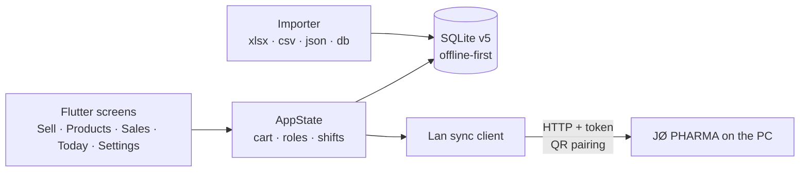

<div align="center">


# JØ PHARMA MOBILE

**A fast, offline point-of-sale for pharmacies on Android — built with Flutter, SQLite and a small LAN sync protocol.**

[](https://github.com/JO-SALEH/POS-APP/releases/latest/download/JO_POS.apk)

[](https://github.com/JO-SALEH/POS-APP/actions/workflows/build-apk.yml)
[](https://github.com/JO-SALEH/POS-APP/releases/latest)


[العربية](README.ar.md) · [Architecture](docs/ARCHITECTURE.md) · [User guide](docs/USER_GUIDE.md) · [PC connection](docs/PC_CONNECTION.md) · [Import guide](docs/IMPORT_GUIDE.md) · [FAQ](docs/FAQ.md) · [Changelog](CHANGELOG.md)


</div>

---

## Why

A pharmacy cannot stop selling because the main computer is busy, the Wi-Fi is down or a second counter is needed. **JØ PHARMA MOBILE** turns any Android phone into a full cash register: scan with the camera, sell by pack / strip / unit, take cash, card, wallet or credit, share the receipt, and let the phone catch up with the main program on the PC later — **without ever losing or double-booking an invoice**.

No account, no cloud, no internet.

## Features

| Area | What you get |
|---|---|
| **Selling** | Continuous camera scanning, hardware / Bluetooth scanners, search by name or *any* barcode, quick-add for unknown barcodes, hold & recall invoices, undo, top-sold shortcuts |
| **Units** | Sell by **pack, strip or single unit** with automatic prices (`price × size / units-per-pack`) and stock taken in base units |
| **Checkout** | Cash / card / wallet / **credit**, customer name, discount (amount or %), tax, amount received and change |
| **Safety** | Expired items are **blocked** (same rule as the main program), near-expiry warnings, shortage confirmation, reorder-level alerts |
| **Credit customers** | Customer suggestions and live **balance** synced from the PC |
| **Returns** | Partial returns limited to what was sold, stock restored, synced to the PC once its sale is there |
| **Shifts & reports** | Open / close shift with cash count and difference, daily totals, payment split, top items, low stock, expiring soon |
| **Roles** | Manager and cashier accounts; cashiers see only what they need |
| **Products** | Import from a JØ PHARMA database, `.xlsx`, CSV/TSV or JSON with automatic column detection and a **mapping screen with live preview**; multi-select, delete, bulk price change, export |
| **PC link** | QR pairing, automatic delivery of invoices and returns, automatic product / price / stock / expiry updates, address re-discovery |
| **Receipts** | Shareable receipt for every invoice |
| **UI** | Dark gold design, Arabic (RTL) and English, built for weak phones |

## Download & install

1. Download [`JO_POS.apk`](https://github.com/JO-SALEH/POS-APP/releases/latest/download/JO_POS.apk) (≈ 71 MB, universal) on your phone.
2. Open it and allow **Install unknown apps** if Android asks.
3. Sign in with `admin` / `1234` and **change it in Settings → Account**.

Requires Android 7.0 (API 24)+ and a camera for scanning. The APK is distributed only through this repository's *Releases* page.

## Under the hood



- **Offline-first:** every sale is written to SQLite first; sync is a background concern.
- **Idempotent sync:** each invoice and return carries a stable client id, so a lost reply can be retried safely.
- **Schema migrations:** the local database upgrades in place from every earlier version (tested).

### A few pieces of the code

**Selling by pack, strip or unit** — one formula, two decimals ([`lib/db.dart`](lib/db.dart))

```dart
int multOf(String unit) => unit == 'pack'
    ? unitsPerPack
    : (unit == 'strip' ? (stripSize > 0 ? stripSize : unitsPerPack) : 1);

double priceFor(String unit) => unit == 'pack'
    ? double.parse(price.toStringAsFixed(2))
    : double.parse((price * multOf(unit) / unitsPerPack).toStringAsFixed(2));
```

**Never sell expired stock** — the PC reports non-expired units, the phone enforces it ([`lib/db.dart`](lib/db.dart))

```dart
int? get available => sellable ?? stock;

bool get expired =>
    expiry.isNotEmpty && expiry.compareTo(todayStr()) < 0 &&
    (sellable ?? 0) <= 0 && (stock ?? 0) > 0;
```

**Delivery that survives bad Wi-Fi** — chunked, retried, re-discovering the PC when its address changes ([`lib/lan.dart`](lib/lan.dart))

```dart
try {
  if (invoices.isNotEmpty) await _pushTo(p, invoices, res);
  await _pushReturns(p, res);
} on LanException catch (e) {
  if (!e.unreachable || !rediscover) rethrow;
  final np = await findDesktop(p);               // same Wi-Fi, new IP
  if (np == null) rethrow;
  await _pushTo(np, await Db.lanInvoices(), res); // only what is still unsent
  await _pushReturns(np, res);
}
```

**Reorder alerts that follow the PC's own levels** ([`lib/db.dart`](lib/db.dart))

```dart
d.query('products',
    where: 'stock IS NOT NULL AND (stock<=? OR '
           '(min_stock>0 AND stock<=min_stock*units_per_pack))',
    whereArgs: [threshold], orderBy: 'stock, name COLLATE NOCASE');
```

More in [docs/ARCHITECTURE.md](docs/ARCHITECTURE.md).

## Project layout

```
lib/
  main.dart            app entry, global background
  theme.dart           design system: colors, buttons, nav bar, empty states, footer
  i18n.dart            Arabic / English strings
  db.dart              SQLite schema v5, models, sales, returns, shifts, reports
  importer.dart        file / database / catalog import with a verified report
  mapping.dart         column detection and mapping
  tableio.dart         CSV / TSV / JSON / xlsx reading and writing
  lan.dart             QR pairing, sales + returns delivery, catalog pull
  services.dart        app state: roles, cart, receipts
  screens/             sell · products · sales · dashboard · settings · scan · login
test_importer/         unit and integration tests (sqflite_common_ffi)
tools/                 Android patching and launcher icons
.github/workflows/     CI: tests, then a release APK
```

## Build & test

```bash
flutter create . --platforms=android --project-name jo_pos_mobile
python3 tools/patch_android.py
flutter pub get
flutter test test_importer
flutter build apk --release
```

CI (GitHub Actions) runs the tests and publishes the APK to the `latest` release on every push to `main`.

## Roadmap

- [ ] iOS build
- [ ] Bluetooth receipt printer
- [ ] Sales charts over time

## Security

Local database only, nothing leaves the phone except to the paired PC on your own network. See [SECURITY.md](SECURITY.md).

## License

All rights reserved — see [LICENSE](LICENSE).

---

<div align="center">

**Developed by [JØ ROYALTY](https://www.jo-royalty.vip)**

</div>
